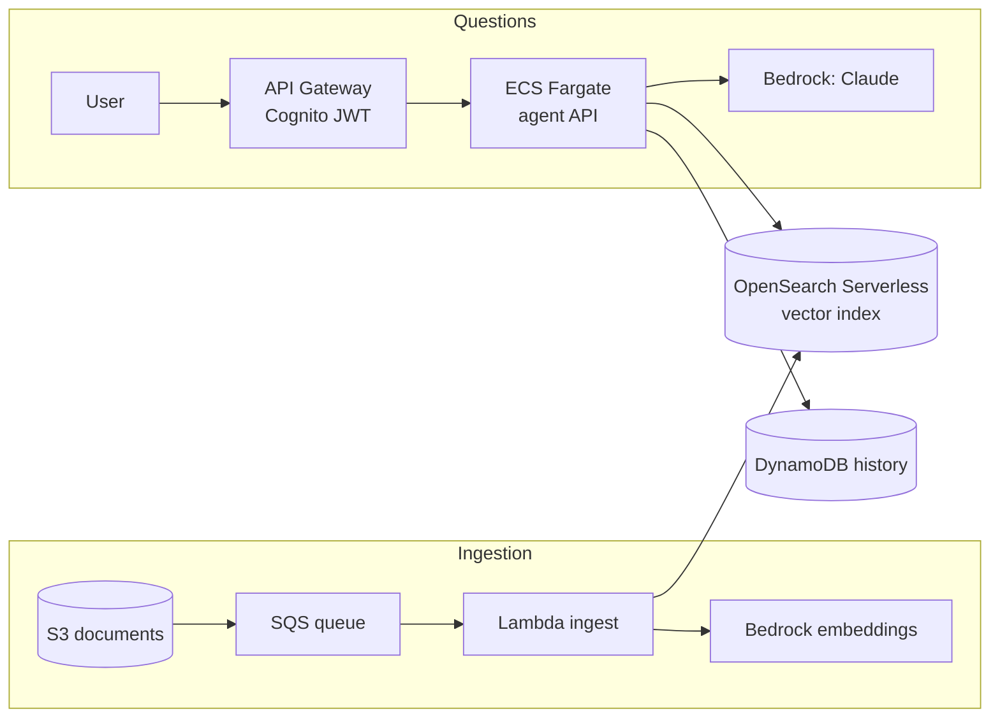

# RAG agent on AWS

A document question-answering agent. Documents dropped in an S3 bucket are chunked, embedded and indexed; a Claude tool-use loop then answers questions from the retrieved passages and names its sources.

The same code runs in two modes:

- **local**: no cloud account needed. A hashing embedder and a JSON-backed vector store stand in for Bedrock and OpenSearch, so the pipeline, the tests and the retrieval eval run offline.
- **aws**: Amazon Bedrock (Claude and Titan embeddings), OpenSearch Serverless, DynamoDB, deployed with the CDK stack in `infra/`.

## Status

What has and has not been verified:

| Area | State |
|---|---|
| Unit tests (53) | Pass locally. AWS and model clients are replaced by fakes. |
| Retrieval eval | Runs offline on the sample documents (results below). |
| CLI `ingest` and `search` | Run locally. |
| CDK stack | Synthesizes to a CloudFormation template (66 resources). **Never deployed.** |
| Calls to Claude, Bedrock, OpenSearch, DynamoDB | **Not exercised against the real services.** |
| Docker image | **Not built.** |

Before a first deployment, check the two points marked in [Known gaps](#known-gaps).

## Architecture



**Ingestion.** An object created in the bucket puts an event on the queue. The Lambda function downloads the file, extracts the text (`.md`, `.txt`, `.pdf`), splits it into overlapping chunks, embeds each chunk and writes it to the vector index. Failed messages are retried three times, then moved to a dead-letter queue.

**Questions.** API Gateway validates the caller's Cognito token and forwards `POST /chat` through a VPC link to the agent service. The agent loads the session history from DynamoDB and calls Claude with one tool, `search_documents`. Claude decides when and what to search; the agent runs each search against the vector index and returns the passages. The loop ends when Claude answers, and the exchange is saved to the history.

## Run it locally

Requires Python 3.11 or newer.

```bash
python -m venv .venv
source .venv/bin/activate        # Windows: .venv\Scripts\activate
pip install -e ".[dev]"
```

Index the sample documents and search them. Neither command calls a model:

```bash
ragagent ingest sample_docs
ragagent search "what happens if my laptop is stolen"
```

Ask the agent. This calls the Claude API, so it needs credentials in the environment (`ANTHROPIC_API_KEY`, or a profile from `ant auth login`) and is billed to that account:

```bash
ragagent ask "How many vacation days can I carry over?"
```

Or run the HTTP API:

```bash
uvicorn ragagent.api:app --port 8000
curl -X POST localhost:8000/chat -H "content-type: application/json" \
  -d '{"session_id": "demo", "message": "Who approves a production deployment?"}'
```

Settings are environment variables; `.env.example` lists them.

## Tests and eval

```bash
pytest
ruff check .
python evals/retrieval_eval.py --min-hit-at-1 0.7
```

The retrieval eval asks 15 questions about the five sample documents and checks which document comes back. With the offline hashing embedder:

| Metric | Result |
|---|---|
| hit@1 | 0.80 |
| MRR | 0.88 |
| hit@4 | 1.00 |

Read these with care. The hashing embedder only matches shared words, and with five one-chunk documents hit@4 is close to guaranteed, so hit@1 is the number that means something. The eval covers retrieval only; it says nothing about the quality of the model's answers. An answer-quality eval is the main thing this project still lacks.

## Deploy to AWS

> **Cost.** This stack is not free-tier. OpenSearch Serverless bills a minimum capacity around the clock, even when idle, and the NAT gateway and load balancer bill by the hour. Check the AWS pricing calculator before deploying, and run `cdk destroy` when you are done.

Requires an AWS account with Bedrock model access granted for Claude and Titan Text Embeddings V2, Docker, Node.js and the CDK CLI.

```bash
cd infra
pip install -r requirements.txt
npx aws-cdk bootstrap
npx aws-cdk deploy
```

The stack outputs the API URL, the documents bucket and the Cognito user pool. Create a user in the pool, upload documents to the bucket, then call `POST {ApiUrl}/chat` with the user's ID token in the `Authorization` header.

`cdk destroy` keeps the documents bucket (it is versioned and set to be retained); delete it by hand if you no longer need it.

## Design decisions

- **A hand-written tool loop instead of an agent framework.** One tool and one loop fit in a single file ([agent.py](src/ragagent/agent.py)) and every stop reason is handled explicitly: tool use, paused turns, refusals, truncated output and a step limit.
- **Retrieval as a tool, not a fixed pipeline step.** The model chooses the query and can search again with other wording, which helps with follow-up questions that depend on the conversation.
- **Retrieved text is treated as data.** The system prompt tells the model not to follow instructions found inside documents, and search failures are reported to the model without leaking internal error text.
- **Embed before deleting.** Re-ingesting a document embeds the new version first, so a failed embedding call leaves the old version searchable.
- **Interfaces with two implementations.** Embedder, vector store and history are small protocols, each with a local and an AWS implementation, which is what makes the offline tests possible.
- **One container image.** The Fargate service and the ingestion Lambda run the same image with different commands.
- **Fargate instead of EC2 or Lambda for the agent.** No servers to patch, and no Lambda timeout on long model turns.

## Known gaps

- **Bedrock permissions.** The task and function roles are granted `bedrock:InvokeModel` on all resources. The IAM actions required by the Bedrock Messages endpoint that `AnthropicBedrockMantle` uses must be confirmed against the AWS documentation, and the resources narrowed to the models in use.
- **OpenSearch Serverless behaviour.** Index creation, document deletion by ID and the k-NN query were written from the API documentation and tested only against a fake client.
- **Public vector endpoint.** The collection is reachable from the internet and protected by IAM-signed requests only. A VPC endpoint would remove the public route.
- **Refusal fallbacks.** On the Claude API the agent enables server-side refusal fallbacks (beta). They are not available on Bedrock, where a declined request returns a fixed message.
- **No streaming.** Answers are returned whole.
- **Scanned PDFs.** Only PDFs with a text layer are supported; there is no OCR step.
- **Deleting a document from S3 does not remove it from the index.**
